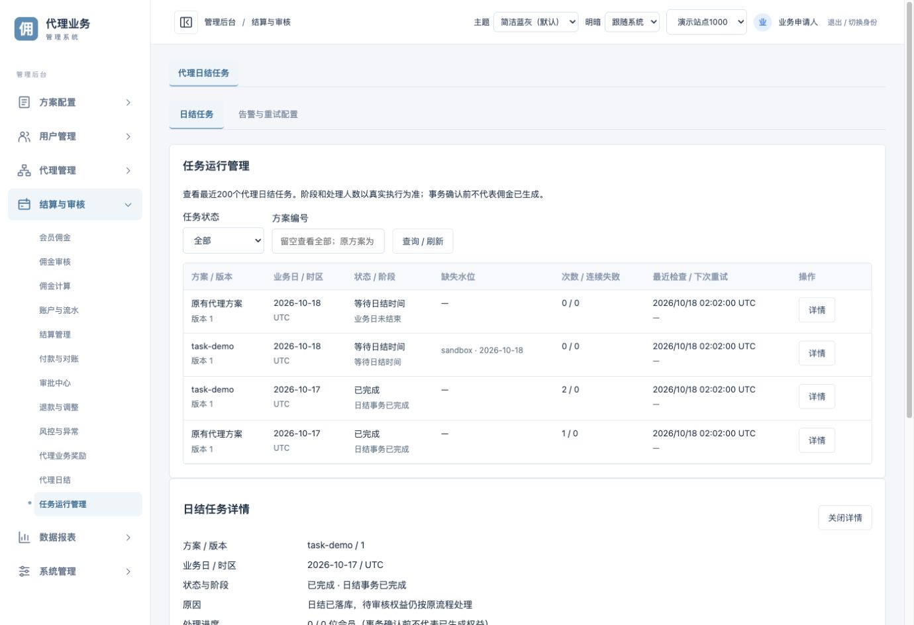
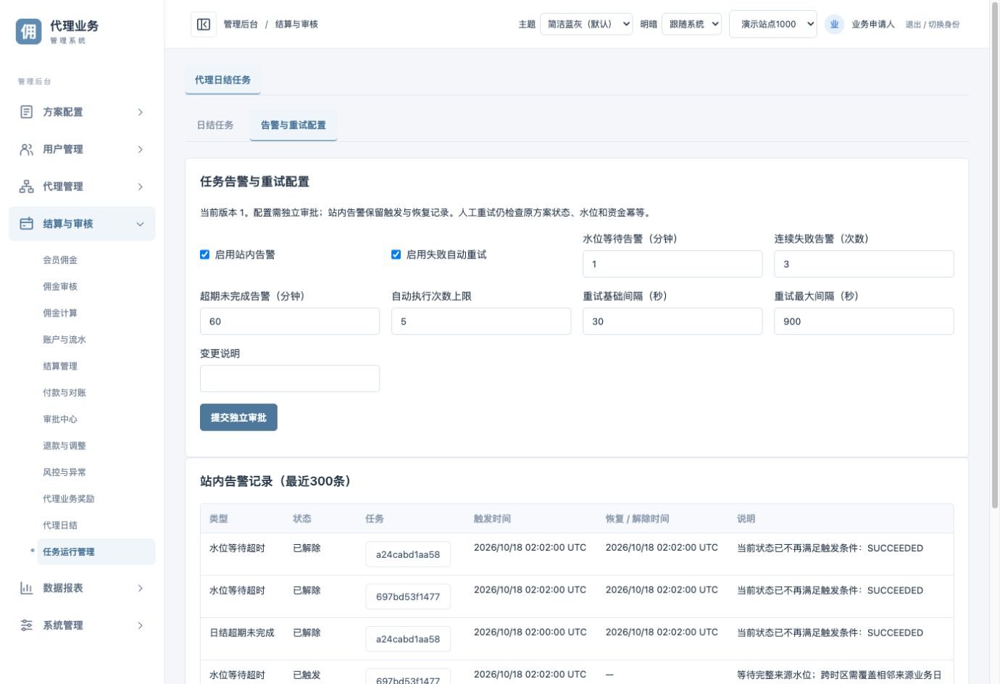

# 代理任务运行管理

入口：「结算与审核 → 任务运行管理」。需要连接包含代理任务模块的 ExCommission 后端，BFF 保持原运营会话、站点绑定与CSRF校验。

- 「日结任务」按状态和方案编号查询最近200条。详情显示方案版本、业务日和时区、缺失水位、原错误、处理人数及最近100次执行历史。
- 日期属于方案时区；执行时间明确显示UTC。
- 申请人填写原因后排队重试，202只代表接收。来源水位缺失仍需来源补齐，停止方案、已完成任务及有效租约中的任务不可强制执行。
- 「告警与重试配置」通过独立审批生效。可设置水位等待、连续失败、日结超期、自动重试次数和退避间隔。只读与审批角色不能修改配置或发起重试。
- 告警表保留触发和解除两类事件，可点击任务编号打开原任务详情。

页面模块位于 `src/modules/finance/TaskRuns.tsx`，详情、告警和数据类型分别独立。API契约随后端同步，不新增登录或资金执行逻辑。

验收：前端构建、27项测试通过；真实浏览器验证只读无写入入口、申请人重试排队、缺失水位检查留痕、配置审批跳转、已生效配置、来源水位补齐后的worker自动日结与告警解除，以及告警任务跳转。演示日无会员事实；会员资格、领取、冲正及资金幂等由后端真实MySQL集成回归验证。

【涉及其他业务】新增后台日结查询与重试申请入口，并接入原审批中心；沿用原角色、站点和CSRF规则。原会员登录、管理员转发和会员领取的前端服务测试通过。未验收真实来源、真实钱包和生产环境。
