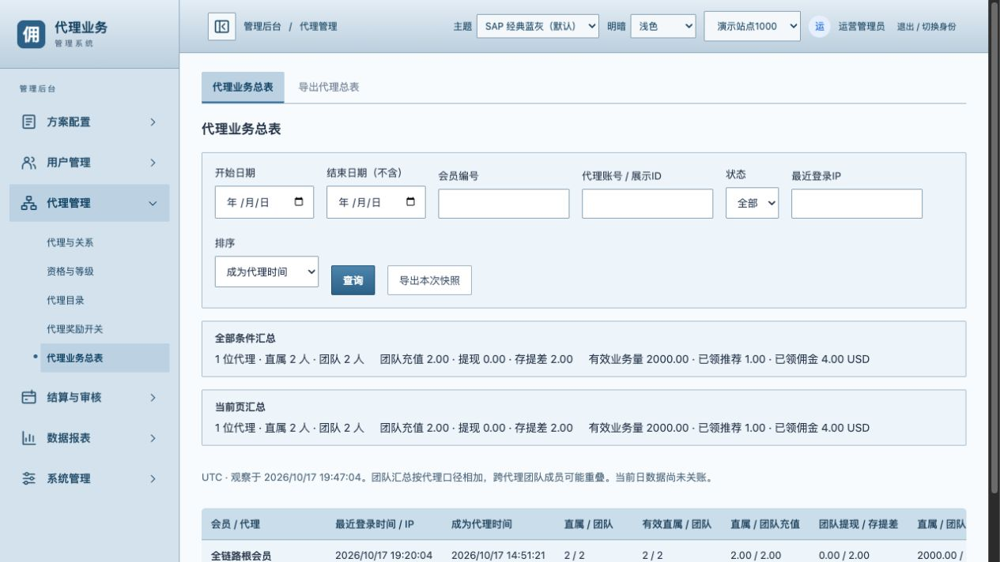
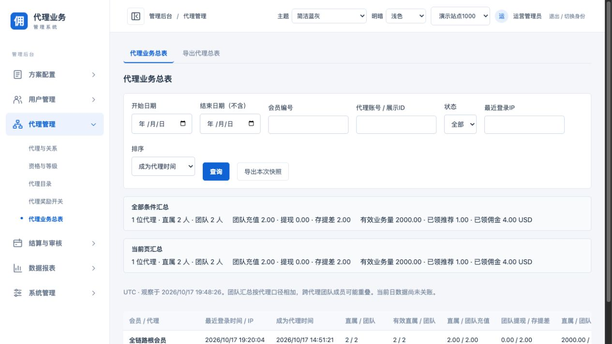
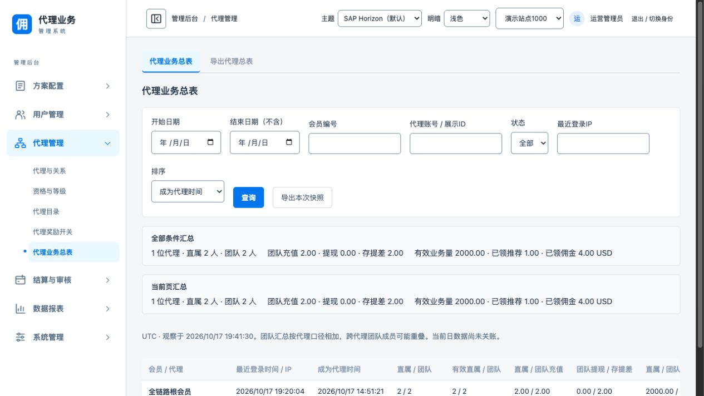
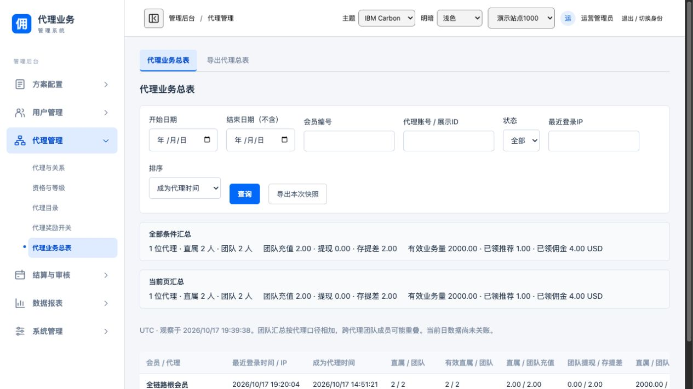

# 前端模块划分与主题

## 页面入口

19486后台右上角“主题”提供SAP经典蓝灰（默认）、简洁蓝灰、SAP Horizon和IBM Carbon。“明暗”独立选择浅色、深色或跟随系统。两项分别保存，刷新后保留；配色作用于管理后台，会员端和登录页继续使用原样式。

SAP经典蓝灰参考用户提供的旧SAP Web Administration Interface截图，以淡蓝侧栏、蓝灰表头和紧凑边框呈现；颜色为近似重建，不是SAP官方主题包或逐像素还原。简洁蓝灰保留原有白色顶栏、白色侧栏和浅灰背景。

Horizon及IBM配色参考：[SAP Morning Horizon](https://www.sap.com/design-system/fiori-design-web/v1-142/foundations/visual/colors/morning-horizon)、[IBM Carbon颜色令牌](https://www.carbondesignsystem.com/building-blocks/foundations/color/tokens)。只参考语义配色，不引入两套组件库。IBM浅色模式使用白色顶栏；Horizon浅色使用白色容器、浅灰页面和蓝色交互。无配色偏好或旧default值使用SAP经典蓝灰，已有显式选择保持。









## 模块职责

```text
src/
  App.tsx                       Session and top-level composition
  admin/
    AdminWorkspace.tsx          Business page selection and lazy loading
    PageBoundary.tsx            Module loading failure boundary
  components/
    Layout.tsx                  Admin shell and existing site controls
    layout/Sidebar.tsx          Navigation display and expand events
    NavigationIcon.tsx          Shared vector icons
  modules/
    appearance/                 Preference, selector and scoped theme CSS
    plans/                      Plans and draft configuration
    affiliate/                  Affiliate rules, reports and calculator
    ingestion/                  Source mapping and configuration approval
    finance/                    Reviews and member commission pages
    member/                     Member portal and affiliate pages
    system/                     System operation catalog
  lib/
    api.ts                      Existing request, site and session binding
    financeMoney.ts             Shared financial display and input parsing
```

App保留原登录、会话、会员入口与退出行为，只组合管理工作区；业务页面不再集中导入App。AdminWorkspace按业务页面加载相应模块，公共目录仍负责菜单描述。已有共享模块可能被多个页面复用，并非每个页面必然独占一个打包文件。接口契约和验证器仍是公共资源。

Layout保留原站点切换逻辑与身份展示；Sidebar只展示完整菜单并回传导航事件，不维护权限。模块懒加载不构成授权边界，后端及既有BFF继续校验权限和站点。

## 后续代码约定

- 页面组件按业务放入modules对应目录，避免将新页面主体堆回App。
- 共享金额、存储或格式化能力放入lib，不能为了复用一个函数而导入完整业务页面。
- 主题状态、持久化和样式留在appearance，业务页面不直接读写主题存储。
- 模块样式限定作用域；新页面应使用统一颜色变量，避免写死白色背景导致深色模式不可读。
- 公共鉴权、站点识别及BFF修改仍需逐次确认，不借模块化移动或绕过相关校验。

## 验证范围

24项现有前端测试、TypeScript与生产构建通过；浏览器验证主题切换及刷新记忆、后台表格和计算器深色显示、计算器懒加载后正常试算。没有进行全部页面的深色视觉逐页验收；仍有公共契约及验证器大资源，未宣称所有页面资源已完全独立。

【涉及其他业务】管理页面组合、侧栏展示及代理/财务/会员共享金额工具的依赖方向。金额格式化和解析函数保持原实现，业务接口、鉴权、站点切换、资金校验及提交协议未变。
