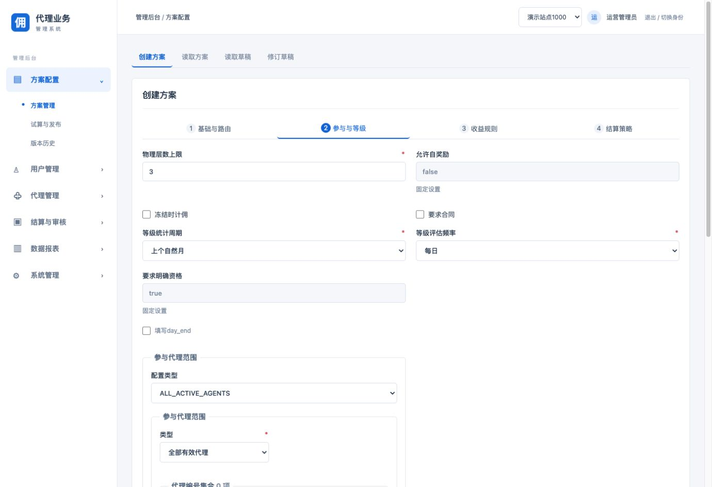
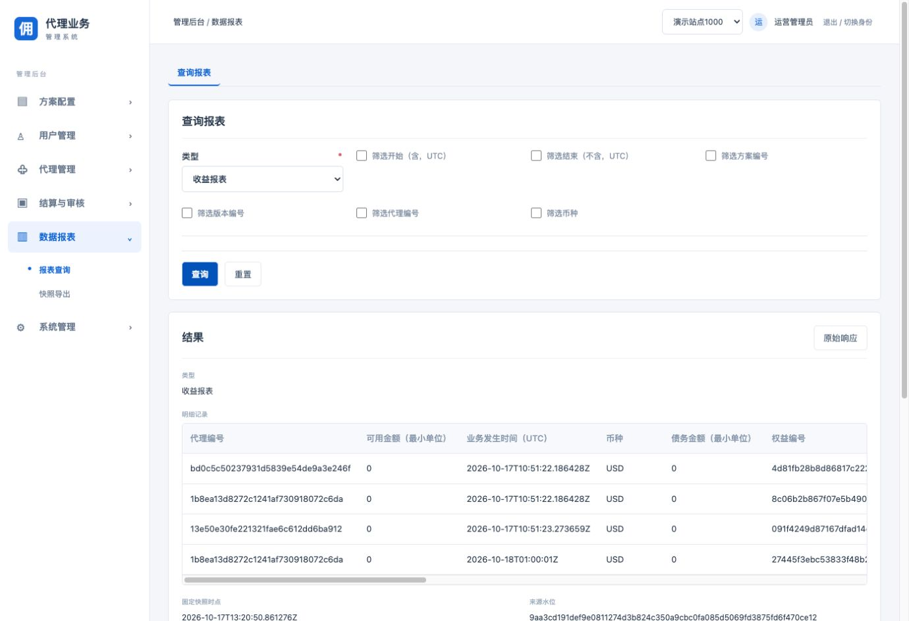

# 管理后台页面整理

2026-10-17，范围为19486管理后台六组菜单。原业务功能、条件参数和权限不删除。

## 统一规则

- 查询条件、编辑表单和结果上下排列，使用完整内容宽度。
- 操作标签可换行，长表格独立横向滚动，结果区随页面滚动。
- 标题、按钮、说明、字段间距、配置分组及复选框统一样式。
- 报表类型、常见字段和可识别枚举中文展示；提交值、金额单位和禁用条件保持。
- 付款错误保留原单核验提示，其它页面不再重复付款说明。

## 覆盖范围

方案配置、用户管理、代理管理、结算与审核、数据报表、系统管理共135个操作导航入口已在真实浏览器逐一切换。入口包含专用业务页面和历史接入说明，不等于135笔业务提交或135项全链路交易验收。

推荐返佣读出全部已发布配置，确认等级、门槛、奖励阶梯、社媒及IP/设备/共享账户规则仍可见；原始业务约束继续生效。报表真实查询成功，并核验中文选项仍对应earnings/finance/cost原接口值。

## 验证

`npm run build`和24项Node测试通过；未知枚举constructor/toString/__proto__及未来值均原样回退。未发起资金操作，未执行每个页面的完整业务提交；未进行真实移动设备验收。

【涉及其他业务】共享字段及枚举展示组件影响后台通用页面，样式限定admin-content；会员端和登录页不使用这些组件及管理布局，认证、站点、审批、CSRF和后端请求协议不改。
